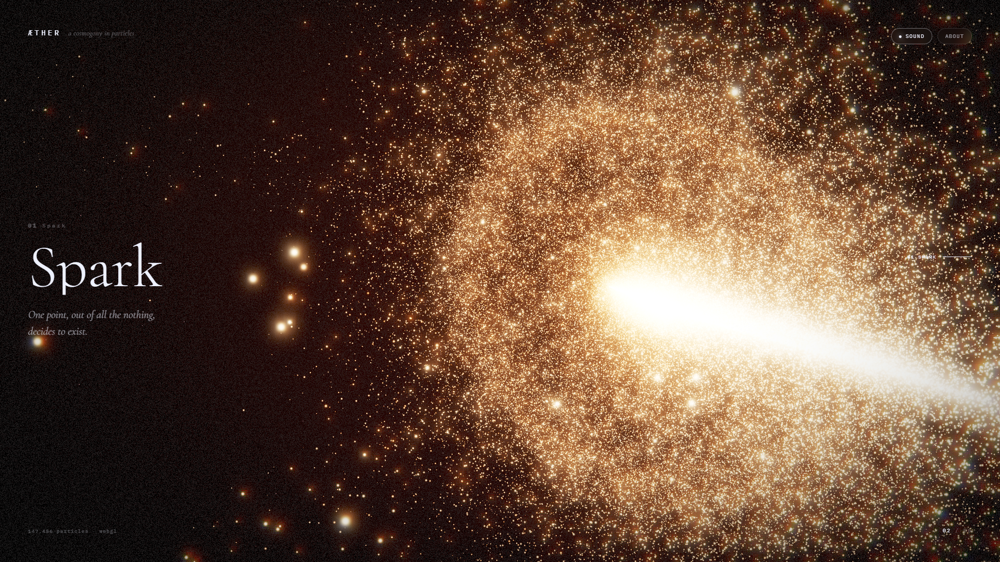
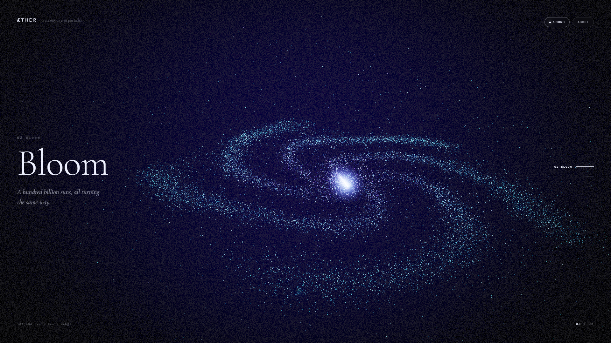
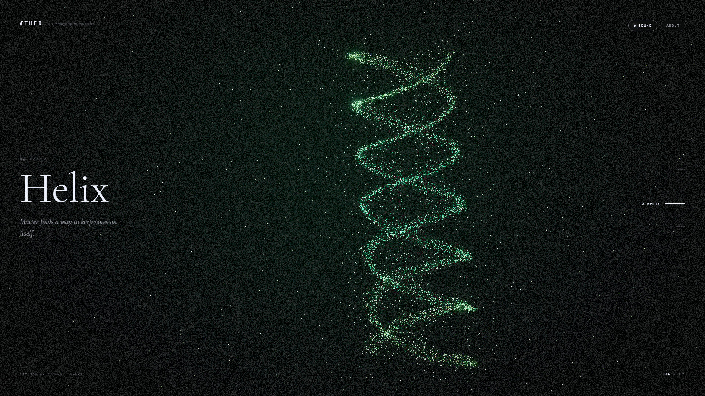
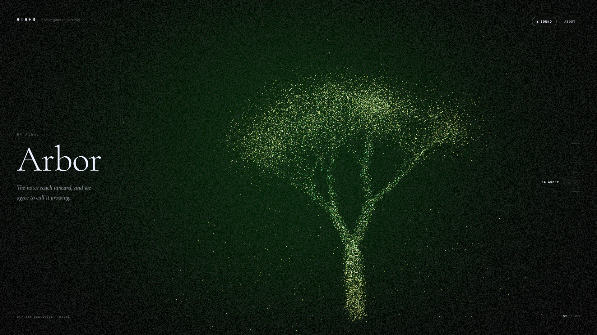
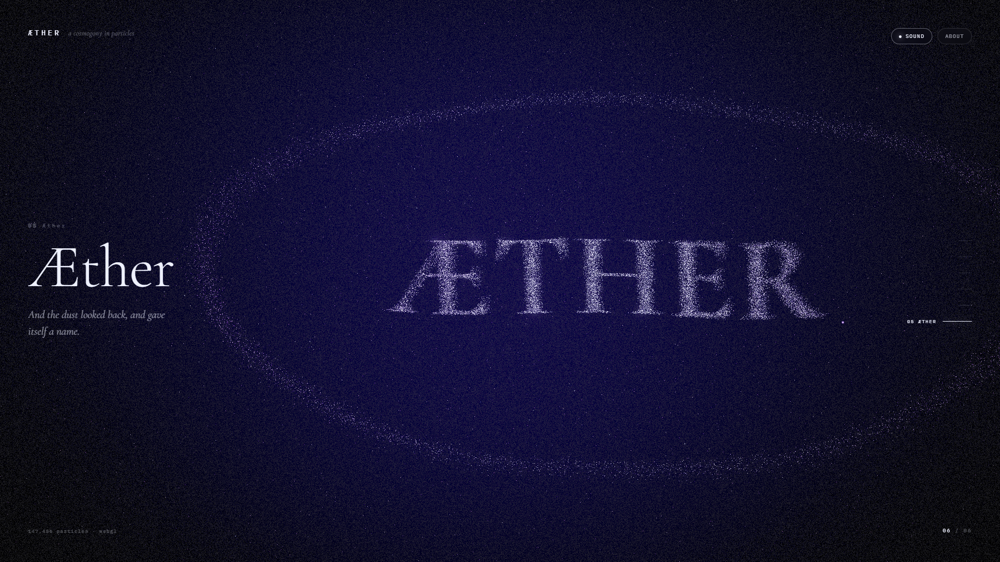
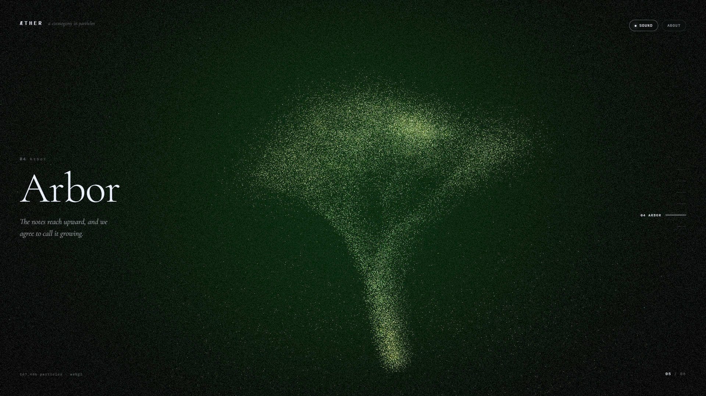

# ÆTHER — A Cosmogony in Particles

**A scroll-driven WebGL experience. One cloud of 147,456 particles retells the birth of everything — from formless dust, to a spark, to a galaxy, to life, to a tree, to a word.**

**Live:** https://claude.ai/code/artifact/b99edfa6-9ec9-4bf5-b6d9-099c0e9c061d

Built for the **3D Websites Hackathon**.

> *"And the dust looked back, and gave itself a name."*

---

## The idea

Every atom in your body heavier than helium was forged inside a star. The iron in your blood was made in a supernova. That is not poetry — it is stellar nucleosynthesis, and it is the strangest true thing I know.

*Æther* runs that fact forwards as a piece of visual music. There is **one** particle cloud in this entire site. It never disappears, never reloads, never cuts. It only ever rearranges itself into the next thing it is about to become — the same dust, six times over:

| | Chapter | What the cloud becomes |
|---|---|---|
| `00` | **Void** | Formless drift. Faint density knots, weather in the emptiness. |
| `01` | **Spark** | Ignition. A molten core inside a thin shell, pierced by flares. |
| `02` | **Bloom** | A five-armed barred spiral, bulge, disc and globular halo. |
| `03` | **Helix** | Two antiparallel strands and their base pairs — matter keeping notes. |
| `04` | **Arbor** | A recursively grown tree: volume-weighted wood, particulate canopy. |
| `05` | **Æther** | The word itself. Matter organised well enough to name itself. |

Between every chapter the cloud tears itself apart into turbulence and reassembles, because nothing in the universe changes shape politely.

**Nothing here is downloaded.** No 3D models. No textures. No images. No audio files. Every one of the six shapes is written as mathematics and generated in your browser at load, and the soundtrack is synthesised live from six oscillators. The entire experience is one 72 kB HTML file plus Three.js.

---

## How it works

The interesting part is that **the morph never touches the CPU.**

**Six shapes in one texture.** At load, each form generator fills a slice of a `Float32Array` with `x, y, z, size` per particle. All six slices become a single `RGBA32F` `DataTexture`, 384 wide by 2304 tall — particle `i` of form `f` lives at a known texel.

**The morph is a texture lookup.** Every vertex samples its own slot in form `A` and form `B` and mixes between them:

```glsl
vec4 slot(float f){
  return texture2D(uTargets, vec2(aUv.x, (f + aUv.y) / uFormCount));
}
```

Because all six targets are resident on the GPU, changing chapter costs nothing — no buffer re-uploads, no allocations, no hitch. Scroll position is just a float, `uChapter`, that can sit anywhere between `0.0` and `5.0`.

**The dissolve.** Each particle carries a random delay, so the cloud comes apart in a wave rather than snapping. Mid-transition, a `sin(π · t)` bell drives a two-octave flow field that scatters everything, then lets it fall back into place.

**Grading.** The scene renders into a half-float HDR buffer, then a hand-written pipeline runs a bright-pass, three cascading gaussian mips, and a composite that does ACES tone mapping, vignette, film grain, and chromatic aberration. The aberration is applied **only to the bloom** — splitting the sharp particle buffer per channel turns single-pixel stars into RGB confetti; splitting the blurred halo gives you the lens fringe without the noise.

**Sound.** Six oscillators, a brown-noise bed and a synthesised convolution reverb. Scroll position retunes the drone continuously (A1 → A2 across the six chapters) and opens the filter with your scroll velocity; locking a chapter strikes a pentatonic bell.

---

## Controls

| | |
|---|---|
| **Scroll** | Travel through the six chapters |
| **Drag** | Orbit the cloud |
| **Move the pointer** | Push a soft hole through the particles |
| **↑ ↓ / PgUp PgDn / Home End** | Jump chapters |
| **Rail, right edge** | Jump to a chapter |
| **Sound** | Toggle the generative ambience |

---

## Running it

No build step, no dependencies to install. Any static server works:

```bash
python -m http.server 8000
# then open http://localhost:8000
```

Three.js is vendored in `vendor/` so the source tree also works offline.

To regenerate the single-file bundles:

```bash
node build.js
```

- `dist/index.html` — the whole site as one self-contained file. Drop it on Netlify, Vercel, GitHub Pages or any static host and you are live.
- `dist/artifact.html` — the same page as a body-only fragment, for hosts that supply their own document wrapper.

---

## Performance

Measured with Chrome on an **Intel UHD 630** — integrated graphics, no discrete GPU:

**60 fps at 1920 × 1080, sustained while scrolling** (the worst case: mid-transition scatter with bloom at maximum).

That comes from a few deliberate choices: all six morph targets live on the GPU so no frame ever uploads a buffer; the turbulence is trigonometric rather than simplex noise; bloom runs at half resolution and below; and there is no depth buffer anywhere, since additive blending does not need sorting.

The piece also adapts to what it is running on:

- **Particle budget** — 147,456 on desktop, 43,264 on touch devices
- **Quality governor** — if frame time drifts past 28 ms, resolution scales down rather than dropping frames
- **`prefers-reduced-motion`** — damps the scatter and the grain
- **Portrait viewports** — the camera pulls back, since field of view is vertical

---

## Screenshots

`docs/screenshots/`

| | |
|---|---|
|  |  |
|  |  |
|  |  |

---

## Technologies and tools

- **Three.js** r160 — scene graph, buffer geometry, render targets
- **WebGL2** — float data textures, vertex texture fetch
- **GLSL ES** — every shader here is hand-written: particle morph, background, bright-pass, separable gaussian, composite
- **Custom post-processing** — no `EffectComposer`; the pipeline is ~140 lines in `js/post.js`
- **ACES filmic tone mapping** (Narkowicz fit)
- **Web Audio API** — oscillators, biquad filters, synthesised convolution reverb
- **Canvas 2D** — used once, to rasterise the final word and harvest its lit pixels as particle coordinates
- **Procedural geometry** — L-system tree, spiral galaxy, double helix, all generated at runtime
- **Vanilla JS, CSS** — no framework, no bundler, no npm dependencies at runtime
- **Google Fonts** — Cormorant Garamond (display), IBM Plex Mono (instrument labels)
- **Claude Opus** (Claude Code) — pair-programming the shaders, choreography and grading

**Assets used: none.** Everything is generated.

---

## Project structure

```
index.html          markup + HUD
css/style.css       interface layer
js/utils.js         seeded RNG, easing, vector helpers
js/forms.js         the six shape generators  ← the heart of it
js/shaders.js       all GLSL
js/post.js          bloom + grade pipeline
js/audio.js         generative ambience
js/app.js           scene, choreography, interaction
vendor/three.min.js Three.js r160 (MIT)
build.js            inlines everything into dist/
```

---

## Hackathon submission

| Requirement | Where |
|---|---|
| Publicly accessible website link | https://claude.ai/code/artifact/b99edfa6-9ec9-4bf5-b6d9-099c0e9c061d |
| Project description and inspiration | **The idea**, above — full write-up in [docs/SUBMISSION.md](docs/SUBMISSION.md) |
| At least 3 screenshots | `docs/screenshots/` — 7 desktop, 7 mobile |
| Demo video *(optional)* | — |
| List of technologies and tools | **Technologies and tools**, above |
| Source code | this repository |

Web-based · meaningful 3D throughout · appropriate for all audiences · solo entry.

---

## Licence

Source: MIT. Three.js is MIT, © Three.js authors.
