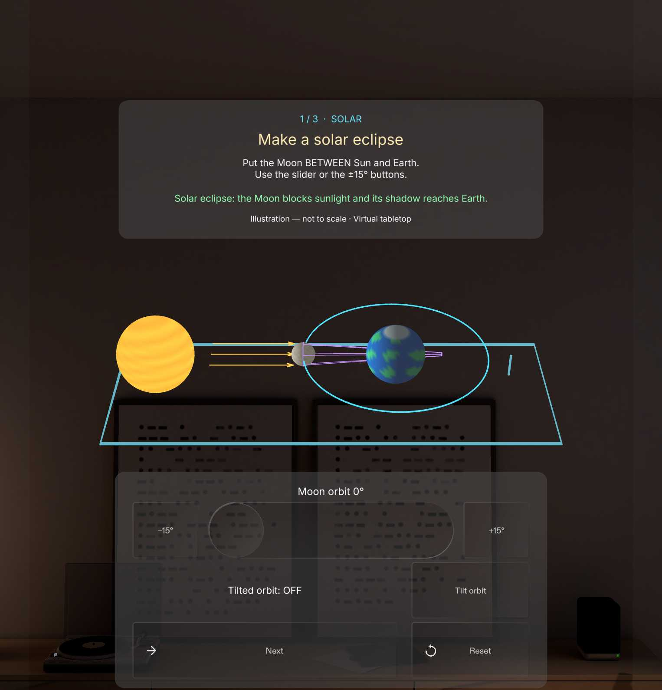

# Orbit Lab

[Devpost project](https://devpost.com/software/orbit-lab-3m8d6z) · [Demo video](https://www.youtube.com/watch?v=7s5lA8JthsY)

A spatial eclipse lesson for SPECS, built and verified in Lens Studio Preview.
Move the Moon, follow its shadow, and solve three challenges: solar eclipse,
lunar eclipse, and orbital tilt. Sizes, distances, tilt and tolerances are
exaggerated teaching aids, not an astronomical simulation.

## Run

Open `SpecsLens.esproj` in Lens Studio 5.23.2 or a compatible newer version.
Use SPECS 27 Interactive Preview with a room environment. Pinch/click Start.
Move the Moon with the orbit slider or the ±15° buttons. Check alignment, then
Next. Solar alignment is 0°; lunar alignment is 180°. In the tilt challenge,
choose Flatten orbit, Check alignment, then Next. Replay and Reset restore
the welcome state. No device, account or network is needed by the lesson.

The instruction card, model and controls are placed in world space. Move the
preview viewpoint to inspect the model from another angle. Real glasses comfort
and hand tracking have not been tested.

## Project

- `Assets/Scripts/OrbitLabMain.ts`: coordinator; `OrbitLabState.ts`: lesson logic.
- `OrbitLabModelMesh.ts` and `OrbitLabGeometry.ts`: animated procedural geometry.
- `OrbitLabInstructionUI.ts`, `OrbitLabControlsUI.ts`, `OrbitLabLayoutUI.ts`: UIKit UI.
- `OrbitLabAudioController.ts`: generated sound effects and quiet ambient loop.
- `Assets/Build/verification.md`: actual QA evidence and limitations.
- `Assets/Build/QA/`: preview captures.
- `devpost/`: authorized design brief, demo plan and continuation notes.
- `devpost-submission.md`: local draft; public links remain separate work.

## Integration tests

Five LEAF scenarios exercise real SIK/UIKit controls, including slider movement,
wrong-answer feedback, three challenges, Replay/Reset and indirect IK pinch
routing. See `Assets/Build/verification.md` for results and how to reattach QA.
Run serially in Preview. Refresh after an IK scenario before using preview tools.
Tests and development helper packages are retained for reproducibility; their
scene objects are detached from the final lesson scene.

## Assets and regeneration

The parametric model and WAV files were generated for this project. Shared
package notices and font/icon licenses are retained with their assets. Audio
generators live in `Assets/Build`; set `CLAD_SKILLS_DIR` to the installed CLAD
skills directory before running them with Node. No runtime AI service is used.

The public repository stores assets directly in Git (about 22 MB total), so a normal
clone includes the required binaries. Local signing keys, account answers,
cache, machine state and video files are excluded from Git.

Public demo: [Watch Orbit Lab on YouTube](https://www.youtube.com/watch?v=7s5lA8JthsY).
